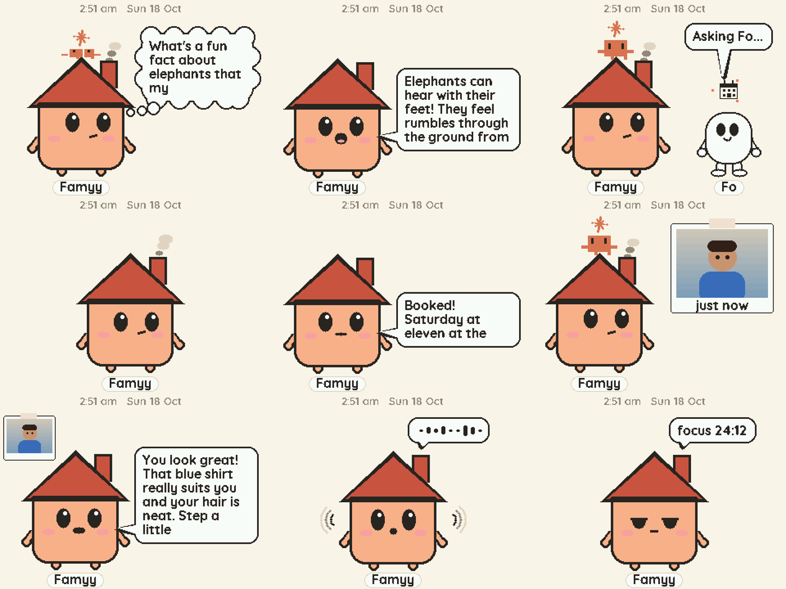

# Famyy: an AI family member on your desk

Famyy (say it "Fammy", like family) is a little robot house with a face that lives on the family desk. Everyone in the home talks to it: it teaches and plays with kids, takes everyday errands off busy parents, and reminds grandparents about their medicines and keeps them company.

You say **"Hey Famyy"**, ask for anything, and Famyy answers out loud. Claude does the thinking, and when something has to happen in the real world (a phone call, a text, an email, shopping, research), Famyy hands the job to **Fo**, Wajo's errand agent, and tells you when it's done.

Built in a weekend for the **GSD hackathon by Wajo** by Karan and Chirag.



*Famyy's real screens, rendered from the firmware's own drawing code: a question in the thought cloud, the answer in a speech bubble, Fo walking in for an errand, and the camera polaroid.*

## What Famyy does

| For | What it can do |
|---|---|
| **Kids** | Explains things simply and asks a question back, quizzes, poems and stories, a tap-to-jump runner game, a Morse code teacher |
| **Parents** | Errands through Fo: calls, texts, emails, research, shopping (always after your OK), timers and a pomodoro, lists on screen |
| **Grandparents** | Daily medicine reminders that keep chiming until someone says "done", a family member gets a text if nobody does, family photos, jokes and company |
| **Everyone** | "How do I look?" with the laptop camera (the photo is never saved), past Fo calls listed and replayed, keeps listening after each answer so a conversation flows |

### A few things to say

- "Hey Famyy, introduce yourself."
- "Remind Dadaji to take his BP tablet every day at 9 am."
- "Ask Fo which planets we can see from Bengaluru tonight." (Fo goes off, Famyy stays free, and reports when Fo is back)
- "Ask Fo to call Karan and tell him dinner is at 8." (Famyy shows an approval card first)
- "How do I look? I have a wedding tomorrow."
- "Show my recent calls." / "Play the call to the restaurant."
- A tap stops Famyy mid-sentence ("Famyy stop" works while it's thinking), and the conversation carries on.

## How it works

```
  Famyy (ESP32-S3)                          brain (Go, on a laptop)                      the world
  ----------------                          -----------------------                      ---------
  "hey Famyy" wake word on the chip   --->  Cartesia ink-whisper: speech to text
  mic records the request                   Claude (Claude Code, Haiku 5.5) thinks  --->  Fo (Wajo MCP):
  screen: Famyy, Fo, bubbles, cards   <---  Famyy's own tools (MCP): reminders,            calls, texts, email,
  speaker plays the answer                  timers, photos, camera, lists, approvals       shopping, research
  touch pad: talk, approve, stop            Cartesia sonic: Famyy's voice (Arushi)
```

- **The device** wakes on "hey Famyy" itself (Espressif ESP-SR), records the request, streams it to the brain over Wi-Fi and plays the reply. Its screen shows Famyy the house, Fo walking in when an errand starts, speech bubbles timed to the voice, approval and reminder cards, and photos.
- **The brain** keeps a Claude Code session warm between turns, so an answer starts about 1.5 s after Claude gets the question, and speaks the reply sentence by sentence as soon as each one is voiced. Fo errands that take a while go on in the background, and Famyy reports when Fo is back.
- The device and brain talk over one TCP connection on the home network: [PROTOCOL.md](PROTOCOL.md).

## Safety and privacy

- Anything that sends a message, calls, books or buys needs a tap (or a spoken "yes") on Famyy's approval card first.
- Calls and texts only between 8 am and 10 pm, unless it's urgent or you confirm.
- Camera photos stay in memory only, and Claude conversations are never written to disk.
- Famyy's Claude has no shell or file access: only web search, Fo and Famyy's own tools.
- Family details, photos, reminders, recordings and all keys stay on the laptop and are git-ignored.

## Hardware

| Part | Notes |
|---|---|
| ESP32-S3 DevKitC-1, N16R8 (16 MB flash, 8 MB PSRAM) | the brain of the device |
| ST7789 320×240 SPI display | SCK 12, MOSI 11, CS 10, DC 9, RST 8, backlight 14 |
| INMP441 I2S microphone | SCK 4, WS 5, SD 6 |
| MAX98357A I2S amplifier + 4 Ω speaker | BCLK 15, LRC 16, DIN 7 (leave the GAIN pin unconnected) |
| Touch pad (a coin or a bit of foil on a wire) | GPIO 2 (capacitive touch) |
| A laptop with a webcam | runs the brain; the webcam is for "how do I look?" |

All pins are in [`firmware/femi/config.h`](firmware/femi/config.h).

## Set it up

### 1. The brain (laptop, Linux)

You need Go 1.24+, [Claude Code](https://claude.com/claude-code) installed and signed in, `ffmpeg` (for the camera), a [Cartesia](https://cartesia.ai) API key, and a Wajo account with Fo.

Connect Fo to Claude Code once, then sign in to it with `/mcp` inside `claude`:

```bash
claude mcp add --transport http --scope user fo https://mcp.api.wajo.ai/fo
```

Add your keys, then start the brain:

```bash
cp brain/.env.example brain/.env   # fill in CARTESIA_API_KEY (and the Claude options); git-ignored
./start-brain.sh
```

Note: the brain currently looks for its own folder at `/home/leog/femi/brain` (`brainDir` in [`brain/cmd/femi-brain/main.go`](brain/cmd/femi-brain/main.go)); change that line if you clone somewhere else.

Optional: copy `family/profile.example.json` to `family/profile.json` with your family's names, medicines and city, and put photos in `family/photos/<album>/` for "show me photos of …".

### 2. The device

Install Arduino IDE 2 with the ESP32 core 3.3.x and the **Adafruit GFX** and **Adafruit ST7735 and ST7789** libraries, and `arduino-cli` (`build.sh` uses the IDE's settings in `~/.arduinoIDE/arduino-cli.yaml`). Then:

```bash
cp firmware/femi/secrets.example.h firmware/femi/secrets.h   # your Wi-Fi, and the laptop's address (hostname -I)
firmware/build.sh femi upload                                # compiles with the right board settings and flashes /dev/ttyACM0
```

`build.sh` sets the board options (16 MB flash, OPI PSRAM, the ESP-SR speech model partition and a 6 MB app). Plug into the board's native **USB** port, not the COM port.

### 3. Talk to it

Wait for Famyy's face and the clock, then say "Hey Famyy". Tap the pad to talk without the wake word, tap again to stop it, and on an approval card tap for yes or hold for no.

Before restarting the brain or flashing the device while someone is using it, `tools/brain-idle.sh 60` waits until nothing is in flight.

## Repository

| Path | What |
|---|---|
| `brain/` | the Go brain: `agent` (Claude Code runner), `femi` (turns, tools, speech queue, errands), `cartesia`, `camera`, `link` (device protocol), `mcp` (tool server), `remind` |
| `brain/prompt.md` | who Famyy is and how it behaves |
| `firmware/femi/` | the ESP32-S3 firmware (Arduino) |
| `firmware/preview/` | renders the device's screen on the laptop, from the firmware's own drawing code |
| `firmware/bringup/` | small sketches used to bring up the amp and speaker |
| `tools/` | `brain-idle.sh`, `esp-speaker.sh` (play laptop audio through the device) |
| `family/` | the example family profile; the real profile, photos and reminders are git-ignored |

## Team

Karan and Chirag, for the GSD hackathon by Wajo, October 2026.
